<p align="center">
  
</p>

<h1 align="center">Lucid Viewer</h1>

<p align="center">
  <b>The photo is on screen before you blink.</b><br>
  A fast, free and open source image viewer and light editor for Windows 10 and 11.<br>
  <a href="https://cemmgrgn.github.io/lucid-viewer/"><b>Website</b></a> · <a href="https://github.com/cemmgrgn/lucid-viewer/releases/latest"><b>Download</b></a> · <a href="https://github.com/cemmgrgn/lucid-viewer/wiki"><b>Wiki</b></a> · <a href="docs/CODE_SIGNING.md">Code signing policy</a>
</p>

<p align="center">
  <a href="https://github.com/cemmgrgn/lucid-viewer/releases/latest"></a>
  <a href="https://github.com/cemmgrgn/lucid-viewer/actions/workflows/build.yml"></a>
  
  <a href="LICENSE.txt"></a>
</p>

<p align="center">
  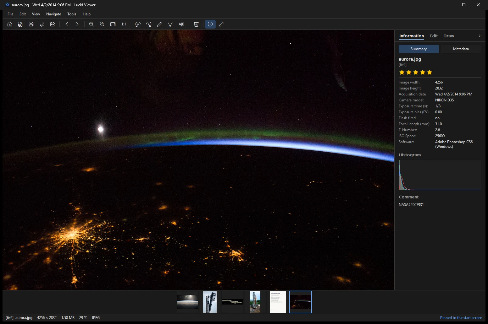
</p>

## Fast

<picture>
  <source media="(prefers-color-scheme: dark)" srcset="docs/images/startup-chart-dark.png">
  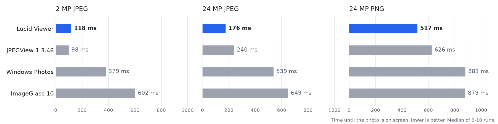
</picture>

| | **Lucid Viewer 1.0** | JPEGView 1.3.46 | Windows Photos | ImageGlass 10 |
|---|:-:|:-:|:-:|:-:|
| 2 MP JPEG on screen | **118 ms** | 98 ms | 379 ms | 602 ms |
| 24 MP JPEG on screen | **176 ms** | 240 ms | 539 ms | 649 ms |
| 24 MP PNG on screen | **517 ms** | 626 ms | 881 ms | 879 ms |
| Memory with the 24 MP JPEG open | **200 MB** | 177 MB | 419 MB | 695 MB |
| Size on disk | **11 MB** (5.4 MB installer) | – | 881 MB | 103 MB |

Lucid Viewer keeps the image pipeline of JPEGView: decoding with libjpeg-turbo, resampling with AVX2 on all CPU cores.
A large photo is shown with a fast first frame and refined right after it, everything that is not needed for the first
frame (star rating, start screen lists, rarely used libraries) is loaded later. With a small photo the original
JPEGView is still about 20 ms faster, it draws no toolbar, side panel or filmstrip.

<details>
<summary>How this was measured</summary>

Each program is started with the image on the command line (Windows Photos as the default app of the file type).
The time runs from starting the process until a magenta marker in the middle of the test image is visible in the new
window, read from the window's own surface, so covered windows count the same. Warm start, the median of 10 runs
(6 for Windows Photos and ImageGlass); memory is the private memory 1.5 s after the image appeared.

- PC: AMD Ryzen 7 7840HS, 16 GB RAM, NVMe SSD, Windows 11 Pro build 26300, 2026-11-05
- Versions: Lucid Viewer 1.0.0, JPEGView 1.3.46, Windows Photos 2026.11090.22001.0, ImageGlass 10.0.6.906
- Test images: generated by the script (6000 × 4000, JPEG quality 92 and PNG; 2 MP is the same image scaled down)
- Raw results: [docs/benchmarks/2026-11-05.jsonl](docs/benchmarks/2026-11-05.jsonl)

Run it yourself:

```
python tools\bench\startup_bench.py --make-image bench24.jpg
python tools\bench\startup_bench.py --name "Lucid Viewer" --image bench24.jpg --runs 10 -- "C:\Program Files\Lucid Viewer\LucidViewer.exe" "{image}"
```
</details>

## Everything in one window

| | **Lucid Viewer** | Windows Photos | ImageGlass | IrfanView | XnView MP | FastStone |
|---|:-:|:-:|:-:|:-:|:-:|:-:|
| Open source | ✅ | ❌ | ✅ | ❌ | ❌ | ❌ |
| Free for commercial use | ✅ | ✅ | ✅ | ❌ | ❌ | ❌ |
| HEIC, AVIF and JPEG XL out of the box | ✅ | ◐ ¹ | ✅ | ◐ ² | ✅ | ◐ ³ |
| Exposure, contrast, color sliders | ✅ | ✅ | ❌ | ✅ | ✅ | ✅ |
| Copy text from images (OCR) | ✅ | ✅ | ❌ | ◐ ⁴ | ❌ | ❌ |
| AI background removal | ✅ | ✅ | ❌ | ❌ | ❌ | ❌ |
| Screenshot tool | ✅ | ❌ | ❌ | ✅ | ✅ | ✅ |
| Batch convert | ✅ | ❌ | ❌ | ✅ | ✅ | ✅ |
| Convert from Explorer's right-click menu | ✅ | ❌ | ❌ | ❌ | ◐ ⁵ | ❌ |

<sub>
Based on each program's own documentation, November 2026. Corrections are welcome in an issue.<br>
¹ HEIC needs the HEVC Video Extensions from the Microsoft Store. ² With plug-ins. ³ Through the codecs installed in Windows.
⁴ With the OCR plug-in and a separate Tesseract install. ⁵ With the separate XnShell extension.
</sub>

## Features

### Start screen
Opened without a photo, Lucid Viewer shows the photos you opened last and the ones you pinned (<kbd>Ctrl</kbd>+<kbd>B</kbd>), with
thumbnails from the Windows cache. <kbd>Alt</kbd>+<kbd>Home</kbd> brings it back.

<p align="center">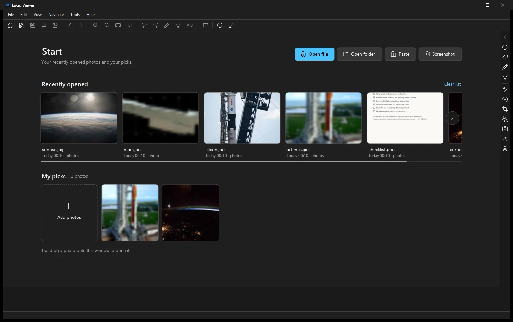</p>

### Edit
Exposure, brightness, contrast, saturation, sharpness, vignette, temperature and tint, local contrast, and an **Auto** button.
Drag the divider to compare before and after (<kbd>Ctrl</kbd>+<kbd>K</kbd>). Crop with aspect ratios, straighten, fix perspective,
resize and rotate JPEGs without loss. Every step can be undone, even a delete or a metadata change.

<p align="center">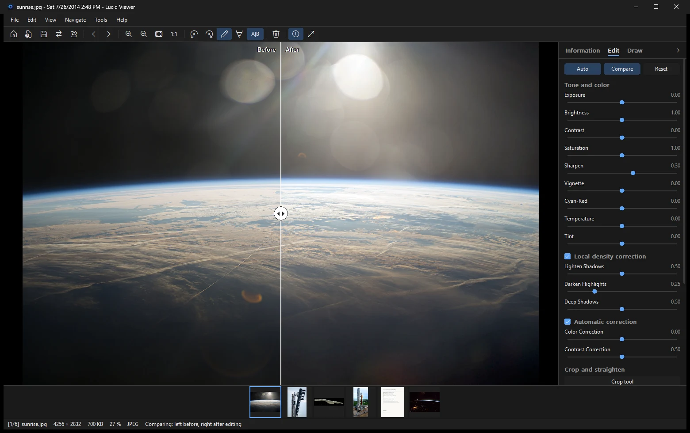</p>

### Draw and sign
Pen, highlighter, rectangle, arrow, text and pixelate. Draw your signature once and place it on any document, then move and
resize it before it is written into the image.

<p align="center">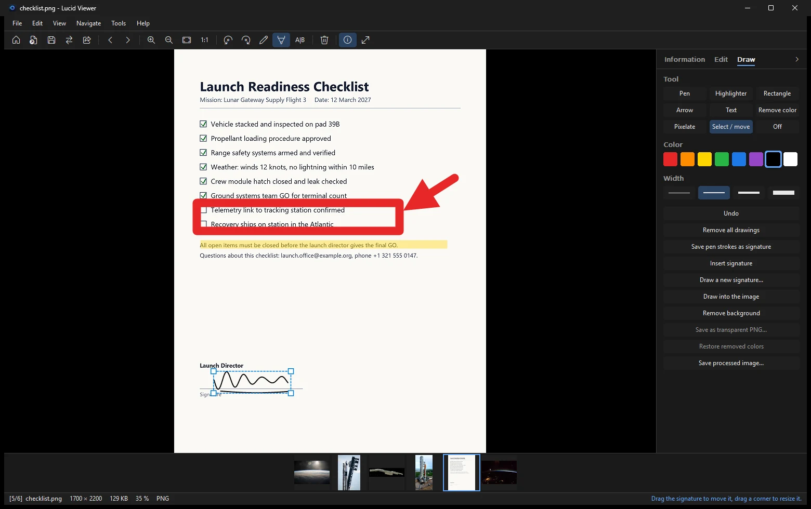</p>

### Remove the background
One click removes the background with an AI model that runs on your PC (U²-Net, downloaded once when you first use it or
during setup). Save the result as a transparent PNG. Nothing is uploaded.

<p align="center">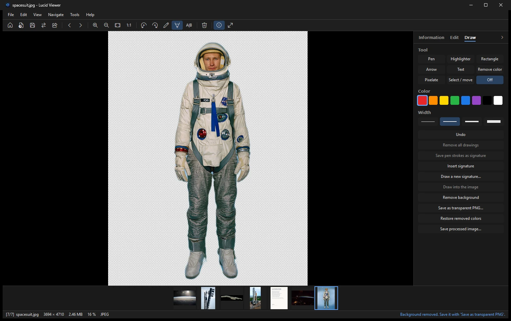</p>

### Copy text (OCR)
<kbd>Ctrl</kbd>+<kbd>Shift</kbd>+<kbd>T</kbd> copies all text of the photo. In the screenshot tool every word is marked and you
select what you need with the mouse. Lucid Viewer uses the text recognition built into Windows, in the language of your keyboard.

<p align="center">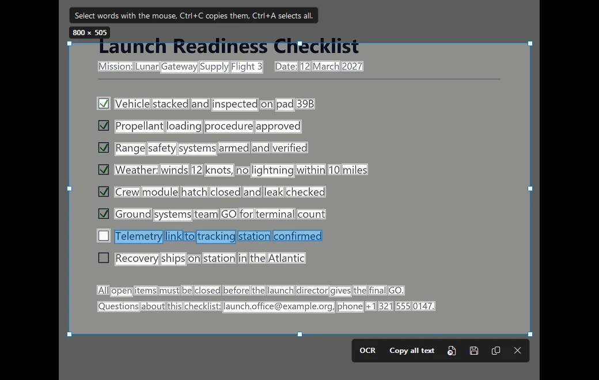</p>

### Screenshot tool
With the screenshot tool switched on (setup or Tools menu), <kbd>PrtScn</kbd> freezes the screen: drag a region or click a window, draw, pixelate, read the text, then copy or save.
A magnifier shows the exact pixel and its color. <kbd>Shift</kbd>+<kbd>PrtScn</kbd> copies the text of a region directly.

<p align="center">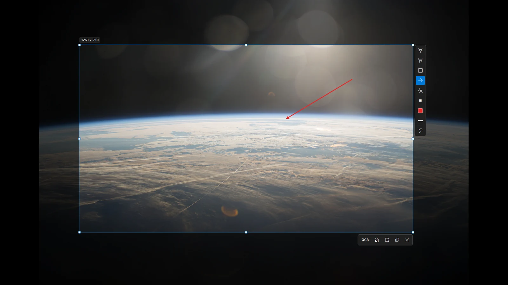</p>

### Convert anywhere
Right-click photos in Explorer → **Convert to** → JPG, PNG, WebP, HEIC, PDF, ICO and more, also resized or without metadata.
Many files are converted in one go. The same works for a whole folder (Tools menu) or from the command line:

```
LucidViewer.exe /convert:fit1920:webp photo.jpg
```

### Organize
Star ratings (keys <kbd>0</kbd>–<kbd>5</kbd>) are written into the file, so Explorer and other programs see them too.
Sort and filter the folder by rating, find similar photos, and view or edit all metadata. One click removes the GPS
location before you share a photo. Copy or move the photo to another folder, or copy the file itself to paste it into
a mail or a chat. Tag photos (the tags are written into the file, as digiKam and Explorer do), filter the folder by a tag,
sort by the date taken and show the place of a photo on the map.

<p align="center">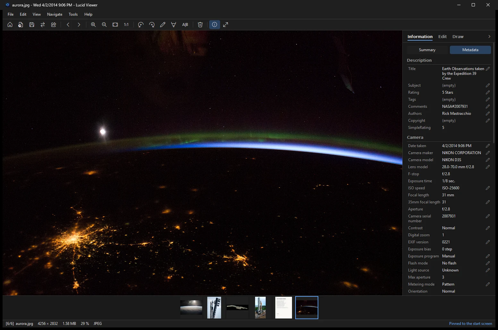</p>

### Make it yours
A searchable settings window and a shortcut editor where you just press the new key. Dark and light theme.

<p align="center">
  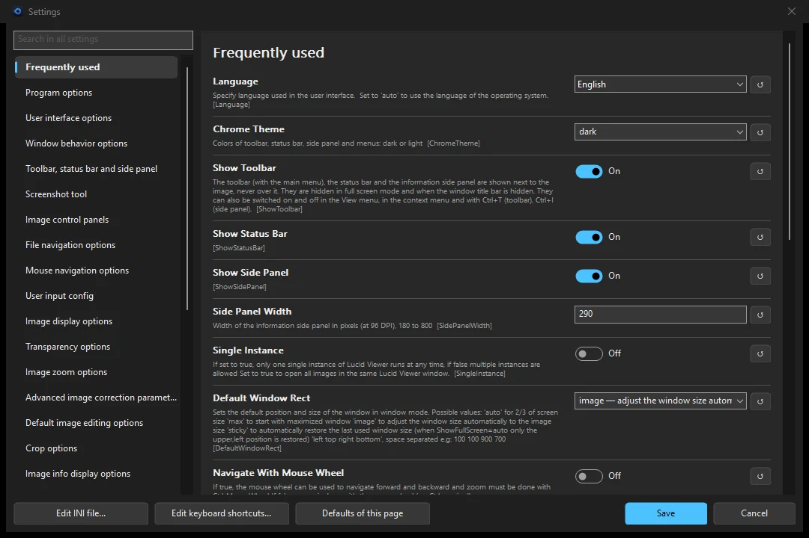
  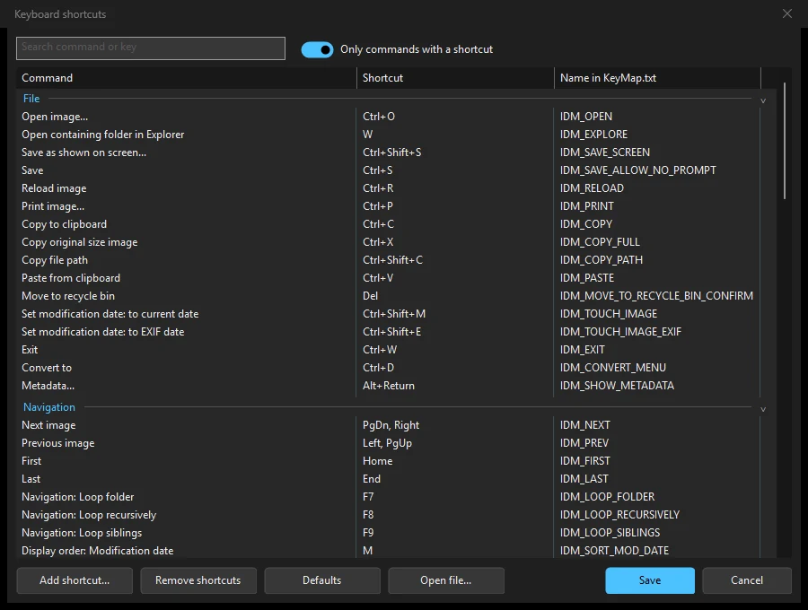
</p>

### Formats
JPEG, PNG and APNG, GIF, WebP, HEIC and HEIF, AVIF, JPEG XL, TIFF, BMP, PSD and PSB, TGA, QOI, JXR, ICO, and camera RAW
files of most cameras (via LibRaw). Other formats with a Windows codec installed open as well.

## Install

Download from the [latest release](https://github.com/cemmgrgn/lucid-viewer/releases/latest):

- **`LucidViewer-1.0.0-Setup-x64.exe`** (recommended). The setup asks what you want:
  - desktop and Start menu shortcuts and the Explorer **Convert to** menu (on by default)
  - Lucid Viewer in *Open with* and *Default apps*
  - the AI model for background removal, downloaded during setup
  - start screen, recent photos, screenshot tool on <kbd>PrtScn</kbd>, theme and layout
- **`LucidViewer-1.0.0-portable-x64.zip`**: extract anywhere and run `LucidViewer.exe`. Settings stay in that folder.

With [winget](https://learn.microsoft.com/windows/package-manager/) (once the package is accepted):

```
winget install CemGirgin.LucidViewer
```

Windows 10 version 1809 or later, 64-bit. If you used JPEGView before, your settings, shortcuts and signature are taken
over on the first start. More in the [wiki](https://github.com/cemmgrgn/lucid-viewer/wiki/Installation), including silent
installation.

## Keyboard shortcuts

| Key | Action | Key | Action |
|---|---|---|---|
| <kbd>←</kbd> <kbd>→</kbd> | Previous / next photo | <kbd>Ctrl</kbd>+<kbd>Z</kbd> / <kbd>Ctrl</kbd>+<kbd>Y</kbd> | Undo / redo |
| <kbd>F11</kbd> | Full screen | <kbd>Ctrl</kbd>+<kbd>K</kbd> | Before / after |
| <kbd>F2</kbd> | Side panel | <kbd>Ctrl</kbd>+<kbd>Shift</kbd>+<kbd>T</kbd> | Copy text (OCR) |
| <kbd>0</kbd>–<kbd>5</kbd> | Star rating | <kbd>Alt</kbd>+<kbd>Enter</kbd> | Metadata |
| <kbd>Del</kbd> | Move to Recycle Bin | <kbd>PrtScn</kbd> | Screenshot tool |
| <kbd>Alt</kbd>+<kbd>Home</kbd> | Start screen | <kbd>F1</kbd> | All shortcuts |

Every shortcut can be changed in **Help → Keyboard shortcuts**.

## Building

Visual Studio 2026 or 2022 with the C++ desktop workload:

```
git clone https://github.com/cemmgrgn/lucid-viewer.git
cd lucid-viewer
git submodule update --init deps/WTL-sf
msbuild src\LucidViewer.sln /t:WICLoader /t:LucidViewer /p:Configuration=Release /p:Platform=x64
```

Details, the installer and the repository layout are in [docs/BUILDING.md](docs/BUILDING.md). Contributions and translations
are welcome, see [CONTRIBUTING.md](CONTRIBUTING.md).

## Credits

Lucid Viewer is based on **[JPEGView](https://github.com/sylikc/jpegview)** and keeps its fast image pipeline at its core.
Thanks to David Kleiner, who wrote JPEGView, to Kevin M ([sylikc](https://github.com/sylikc)), who maintained it,
to [qbnu](https://github.com/qbnu/jpegview) for the updated codecs, and to all JPEGView translators and contributors.
The libraries Lucid Viewer uses are listed in [THIRD_PARTY_NOTICES.md](THIRD_PARTY_NOTICES.md).

The photos in this README are by NASA ([images.nasa.gov](https://images.nasa.gov)), not copyrighted. NASA does not endorse Lucid Viewer.

## License

GNU General Public License v2.0 or later, see [LICENSE.txt](LICENSE.txt). [Code signing policy](docs/CODE_SIGNING.md).
