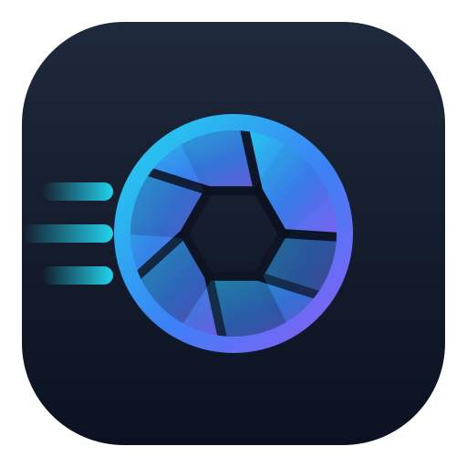

<p align="center">
  
</p>

<h1 align="center">Lucid Viewer</h1>

<p align="center">
  <b>The image viewer that opens before you blink.</b><br>
  Fast, free and open source viewer and light editor for Windows 10 and 11.
</p>

<p align="center">
  <a href="https://github.com/cemmgrgn/lucid-viewer/releases/latest"></a>
  <a href="https://github.com/cemmgrgn/lucid-viewer/actions"></a>
  
  <a href="LICENSE.txt"></a>
</p>

<p align="center">
  
</p>

---

## Why Lucid Viewer

<!-- TODO: fill in measured numbers from tools/bench/startup_bench.py before release.
     Every competitor cell below must be checked against the installed version listed in the footnote. -->

| | **Lucid Viewer** | Windows Photos | ImageGlass | IrfanView | XnView MP | FastStone |
|---|:-:|:-:|:-:|:-:|:-:|:-:|
| **Time to show a 24 MP JPEG** ¹ | **TBD ms** | TBD ms | TBD ms | TBD ms | TBD ms | TBD ms |
| **Time to show a 24 MP PNG** ¹ | **TBD ms** | TBD ms | TBD ms | TBD ms | TBD ms | TBD ms |
| **Memory with one photo open** | **TBD MB** | TBD MB | TBD MB | TBD MB | TBD MB | TBD MB |
| **Install size** | **TBD MB** | TBD MB | TBD MB | TBD MB | TBD MB | TBD MB |
| Open source | ✅ | ❌ | ✅ | ❌ | ❌ | ❌ |
| No ads, no account, no telemetry | ✅ | ❌ | ✅ | ✅ | ✅ | ✅ |
| HEIC, AVIF, JPEG XL, RAW without extra codecs | ✅ | ❌ | ✅ | ✅ ² | ✅ | ❌ |
| Light editing (exposure, contrast, temperature, vignette…) | ✅ | ✅ | ❌ | ✅ | ✅ | ✅ |
| Before / after comparison slider | ✅ | ❌ | ❌ | ❌ | ❌ | ❌ |
| Undo / redo for every edit | ✅ | ✅ | ❌ | ❌ | ✅ | ✅ |
| Draw, annotate and sign | ✅ | ✅ | ❌ | ✅ | ✅ | ✅ |
| Copy text from images (OCR) | ✅ | ❌ | ❌ | ✅ ² | ❌ | ❌ |
| AI background removal (offline) | ✅ | ✅ | ❌ | ❌ | ❌ | ❌ |
| Screenshot tool with markup and OCR | ✅ | ❌ | ❌ | ✅ | ✅ | ✅ |
| Convert from Explorer's right-click menu | ✅ | ❌ | ❌ | ❌ | ✅ ³ | ❌ |
| Batch convert a folder | ✅ | ❌ | ❌ | ✅ | ✅ | ✅ |
| Star ratings, filter and sort by rating | ✅ | ❌ | ❌ | ❌ | ✅ | ✅ |
| Edit and strip metadata (incl. GPS) | ✅ | ❌ | ❌ | ✅ | ✅ | ❌ |
| Find similar / duplicate photos | ✅ | ❌ | ❌ | ❌ | ✅ | ❌ |
| Dark and light theme | ✅ | ✅ | ✅ | ❌ | ✅ | ✅ |

<sub>
¹ Time from starting the program until the image is on screen, median of 10 runs on the same PC, measured with
<a href="tools/bench/startup_bench.py"><code>tools/bench/startup_bench.py</code></a>. Hardware and versions: TBD.<br>
² With the official plug-in pack. ³ With the separate XnShell extension.
</sub>

## Features

### Viewing
- Opens JPEG, PNG, GIF, WebP, HEIC/HEIF, AVIF, JPEG XL, TIFF, BMP, PSD, QOI, TGA, JXR and camera RAW files (via LibRaw) out of the box.
- Start screen with recent, pinned and screenshot photos instead of an empty window.
- Filmstrip, smooth zoom, fullscreen, slideshow, multi-monitor support.
- Info panel with histogram, EXIF summary and a full metadata view.

<p align="center"></p>

### Editing
- Exposure, contrast, brightness, saturation, temperature, tint, sharpness, vignette and local contrast sliders, with an **Auto** button.
- Before / after comparison with a draggable divider (<kbd>Ctrl</kbd>+<kbd>K</kbd>).
- Crop with aspect ratios, straighten, perspective correction, resize, lossless JPEG rotation.
- Undo and redo for everything, including deletes and metadata edits.

<p align="center"></p>

### Draw and sign
Pen, highlighter, rectangle, arrow, text and pixelate tools. Save your signature once and drop it on any document; move and resize it before it is burned in.

<p align="center"></p>

### Copy text (OCR)
Press <kbd>Ctrl</kbd>+<kbd>Shift</kbd>+<kbd>T</kbd>: every word is highlighted, select with the mouse and copy. Uses the built-in Windows OCR, or the optional **PP-OCR** model for harder text.

<p align="center"></p>

### Remove background
One click removes the background with an on-device AI model and saves a transparent PNG. Nothing is uploaded.

<p align="center"></p>

### Screenshot tool
<kbd>PrtScn</kbd> freezes the screen: pick a region or a window, annotate, pixelate, OCR, copy or save. A magnifier shows coordinates and pixel colors.

<p align="center"></p>

### Convert anywhere
Right-click images in Explorer → **Convert to** → JPG, PNG, WebP, HEIC, PDF and more, with resize presets. Many files are converted in one go with a progress window. The same presets work from the command line:

```
LucidViewer.exe /convert:fit1920:webp photo.jpg
```

<p align="center"></p>

### Organize
Star ratings (keys <kbd>0</kbd>–<kbd>5</kbd>) stored in the file, filter and sort by rating, metadata editor that can strip your GPS location in one click, and a similar photo finder.

<p align="center"></p>

### Make it yours
Searchable settings page, a shortcut editor where you just press the new key, dark and light themes.

<p align="center">
  
  
</p>

## Install

**Installer (recommended):** download `LucidViewer-Setup-x64.exe` from the [latest release](https://github.com/cemmgrgn/lucid-viewer/releases/latest). During setup you can choose:

- Desktop and Start menu shortcuts *(on by default)*
- Explorer right-click **Convert to** menu *(on by default)*
- File associations
- Optional AI models, downloaded during setup: background removal, enhanced OCR

**Portable:** download the `.zip`, extract it anywhere and run `LucidViewer.exe`. Settings are kept next to the program when the folder is writable.

Requires Windows 10 version 1809 or later, 64-bit.

## Keyboard shortcuts

| Key | Action | Key | Action |
|---|---|---|---|
| <kbd>←</kbd> <kbd>→</kbd> | Previous / next image | <kbd>Ctrl</kbd>+<kbd>Z</kbd> / <kbd>Y</kbd> | Undo / redo |
| <kbd>F11</kbd> | Fullscreen | <kbd>Ctrl</kbd>+<kbd>K</kbd> | Before / after |
| <kbd>F2</kbd> | Info panel | <kbd>Ctrl</kbd>+<kbd>Shift</kbd>+<kbd>T</kbd> | Copy text (OCR) |
| <kbd>0</kbd>–<kbd>5</kbd> | Star rating | <kbd>Alt</kbd>+<kbd>Enter</kbd> | Metadata |
| <kbd>Del</kbd> | Move to Recycle Bin | <kbd>PrtScn</kbd> | Screenshot tool |
| <kbd>Alt</kbd>+<kbd>Home</kbd> | Start screen | <kbd>F1</kbd> | All shortcuts |

All shortcuts can be changed in **Help → Keyboard shortcuts**.

## Building from source

Visual Studio 2022 or 2026 with the *Desktop development with C++* workload (MSVC, ATL, Windows 11 SDK).

```
git clone https://github.com/cemmgrgn/lucid-viewer.git
cd lucid-viewer
msbuild src\LucidViewer.sln /p:Configuration=Release /p:Platform=x64
```

The installer is built with [Inno Setup 6](https://jrsoftware.org/isinfo.php): `iscc installer\LucidViewer.iss`. See [docs/BUILDING.md](docs/BUILDING.md) for details.

## Credits

Lucid Viewer started as a fork of **JPEGView** and keeps its fast image pipeline at its core. Thanks to David Kleiner, the original author, to [sylikc](https://github.com/sylikc/jpegview) who maintained the re-release, to [qbnu](https://github.com/qbnu/jpegview) for the updated codecs, and to every JPEGView translator and contributor.

Third-party libraries and models are listed in [THIRD_PARTY_NOTICES.md](THIRD_PARTY_NOTICES.md).

## License

GNU General Public License v2.0 or later, see [LICENSE.txt](LICENSE.txt).
