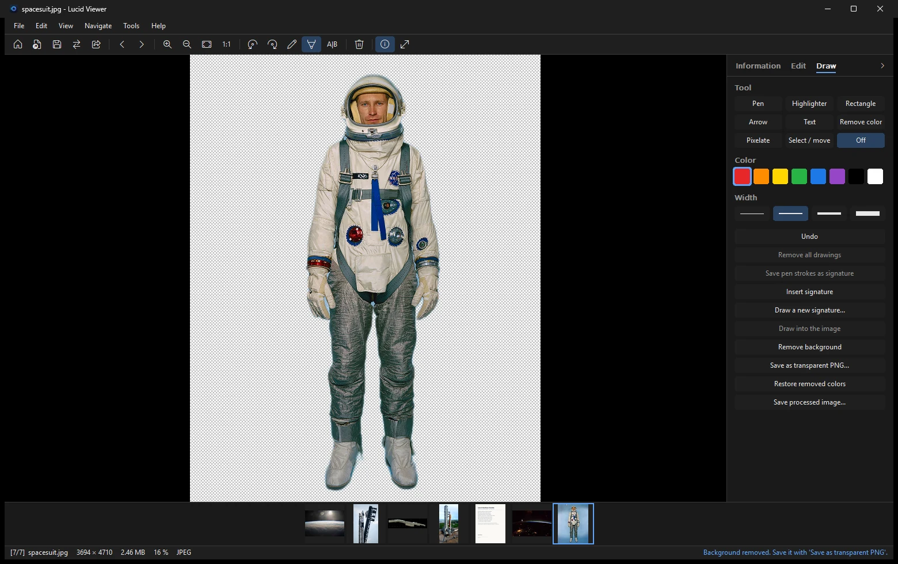

# Background removal

Lucid Viewer can remove the background of a photo with an AI model. The model runs on your PC. Nothing is uploaded.

## How it works

- The model is **U²-Net**. It is released under the MIT license.
- The model file is about 168 MB.
- It runs on your PC with Windows ML.
- The model is downloaded once. You get it either during setup, or the first time you use the feature.

## Remove a background

1. Open the photo.
2. Open the **Draw** tab of the side panel and click **Remove background**.
3. Wait for the result. The removed background is shown as a checkerboard.
4. Click **Save as transparent PNG...**. **Restore removed colors** brings the background back.

## Results

The model works best on people and objects.

It is weaker on crowded scenes. If the result is not right, try a photo with a clearer subject.

## Color removal

The color removal tool is a second way to clear a background. It works on a background of one color. The result can be saved as a transparent PNG too.

## Saving

Save the result as a PNG to keep the transparency. JPEG files have no transparent areas, so the background would turn into a solid color.

## Model download problems

If the model cannot be downloaded during setup, setup continues. Lucid Viewer downloads the model the next time you use the feature. The download comes from GitHub.

See [[Installation|Installation]] for the setup options, and [[Code signing and privacy|Code-signing-and-privacy]] for what the network is used for.
