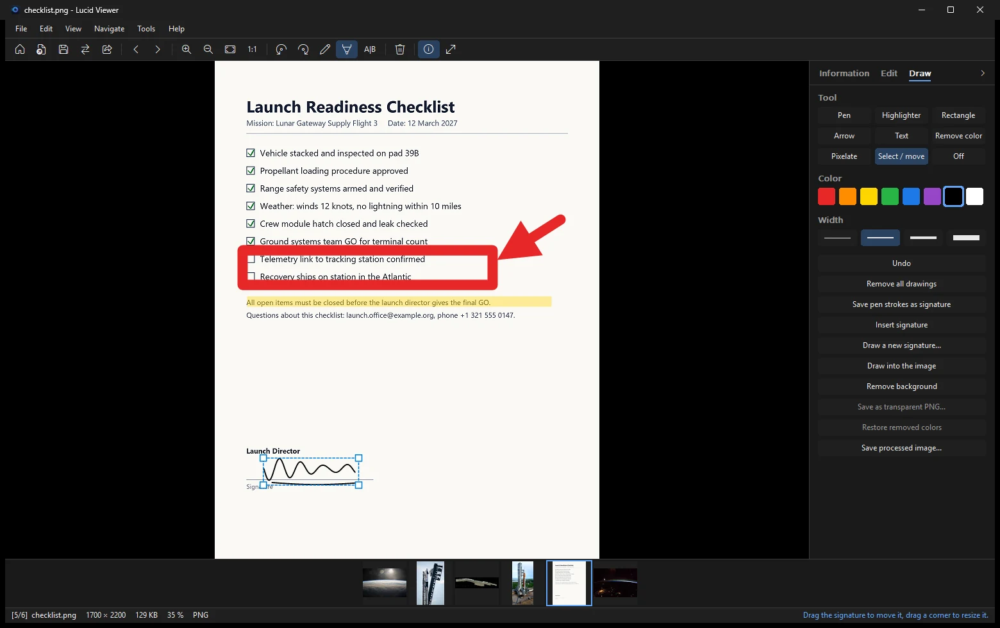

# Drawing and signatures

Draw on a photo with the **Draw** tab in the side panel. Press <kbd>Ctrl</kbd>+<kbd>Shift</kbd>+<kbd>D</kbd> to draw and write on the image.

## Tools

| Tool | Use it for |
|---|---|
| Pen | Free drawing and handwritten notes |
| Highlighter | Marking a part of the image without hiding it |
| Rectangle | Framing an area |
| Arrow | Pointing at something |
| Text | Adding a line of text |
| Pixelate | Hiding a detail, such as a name or a number |
| Select and move | Choosing a mark or a signature, then moving or resizing it |

## Signature

Draw your signature once. Lucid Viewer keeps it for later use, so you can place it on any document.

- The signature is stored in `%APPDATA%\LucidViewer\signature.txt`.
- Place the signature on the photo, then move and resize it until it fits.
- The signature is written into the image when you save.

The uninstaller can remove the stored signature. See [[Installation|Installation]].

## Undo and changes

Drawing changes are part of the image when you save it. To remove a mark, press <kbd>Ctrl</kbd>+<kbd>Z</kbd> to undo. You can undo as many steps as you need. See [[Editing|Editing]] for more about undo and saving.

## Tip

Use the pixelate tool before you share a photo with names, faces or numbers on it.
