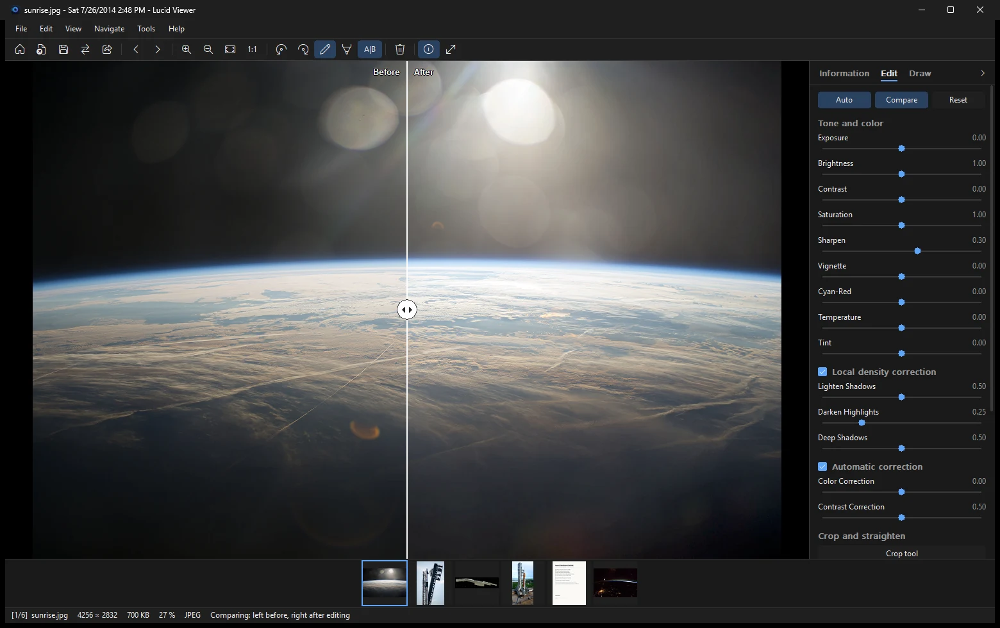

Lucid Viewer has a side panel with three tabs: **Information**, **Edit** and **Draw**. Open the information panel with <kbd>Ctrl</kbd>+<kbd>I</kbd>. Open the edit tools with <kbd>Ctrl</kbd>+<kbd>E</kbd>. Drawing tools are on the Draw tab, or press <kbd>Ctrl</kbd>+<kbd>Shift</kbd>+<kbd>D</kbd>.

## Sliders

The **Edit** tab has sliders for:

- exposure
- brightness
- contrast
- saturation
- sharpness
- vignette
- temperature and tint
- local contrast

Use the **Auto** button to let the program set the sliders for you. You can then adjust them by hand.

Some sliders also work with keys. See [[Keyboard shortcuts|Keyboard-shortcuts]] for the full list:

| Key | Action |
|---|---|
| <kbd>Ctrl</kbd>+<kbd>Plus</kbd> / <kbd>Ctrl</kbd>+<kbd>Minus</kbd> | More or less contrast |
| <kbd>Shift</kbd>+<kbd>Plus</kbd> / <kbd>Shift</kbd>+<kbd>Minus</kbd> | Brightness up or down |
| <kbd>Alt</kbd>+<kbd>Plus</kbd> / <kbd>Alt</kbd>+<kbd>Minus</kbd> | Sharpen more or less |
| <kbd>F5</kbd> | Automatic color and contrast correction on or off |

## Before and after

Press <kbd>Ctrl</kbd>+<kbd>K</kbd> to compare the edited image with the original. Drag the divider to show more of one or the other. Press <kbd>Esc</kbd> to leave the comparison.

## Crop and straighten

Drag with the left mouse button to select the area you want to keep. The crop menu has aspect ratios and a fixed size. You can also set your own ratio.

Straighten and correct the perspective with the rotate and perspective tools. The grid lines help you line up the horizon or the walls.

JPEG files can be rotated without quality loss:

- <kbd>R</kbd> rotates 90 degrees clockwise.
- <kbd>T</kbd> rotates 90 degrees counterclockwise.

## Resize

Resize changes the pixel size of the photo. Save the file to keep the new size. To resize many photos at once, use the conversion tools. See [[Converting images|Converting-images]].

## Undo and redo

Every change can be undone, even a delete or a metadata change.

- <kbd>Ctrl</kbd>+<kbd>Z</kbd> undoes the last step.
- <kbd>Ctrl</kbd>+<kbd>Y</kbd> or <kbd>Ctrl</kbd>+<kbd>Shift</kbd>+<kbd>Z</kbd> redoes it.

## Saving and export

- <kbd>Ctrl</kbd>+<kbd>S</kbd> saves the changes to the file. By default the program asks before it overwrites the original file.
- <kbd>Ctrl</kbd>+<kbd>Shift</kbd>+<kbd>S</kbd> saves the image as it is shown on screen.

The export dialog shows an estimate of the file size.

The default format and the quality are set in the settings:

| Setting | Default | Meaning |
|---|---|---|
| `DefaultSaveFormat` | `jpg` | Default format for saving |
| `JPEGSaveQuality` | `85` | JPEG quality, 0 to 100 |
| `WEBPSaveQuality` | `85` | WebP quality, 0 to 100 |

See the [[Settings reference|Settings-reference]] for all settings.

Setting `OverwriteOriginalFileWithoutSaveDialog` to `true` makes <kbd>Ctrl</kbd>+<kbd>S</kbd> overwrite the original file without a question. The original cannot be restored, so keep this setting off unless you are sure.

## Share

You can also send the photo to another app with the Windows share window. The photo goes only where you send it.
