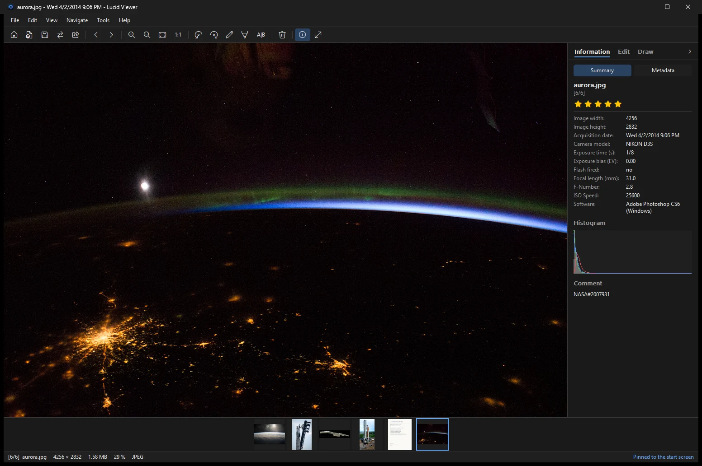

Lucid Viewer is a fast image viewer and light editor for Windows 10 and 11. It is free and open source, and it is based on JPEGView. You can view photos, adjust them, draw on them, convert them, remove the background and copy text from images. The program is licensed under the GNU General Public License, version 2 or later.

  

## Features

- Opens photos quickly. A large photo shows a first frame fast and is refined right after.
- Edit exposure, contrast, color, sharpness and more. Compare the result with the original.
- Crop, straighten, resize and rotate. JPEG files can be rotated without quality loss.
- Draw, highlight, add text and pixelate. Keep a signature and place it on documents.
- Remove the background with an AI model that runs on your PC. Nothing is uploaded.
- Copy text from images with the text recognition that comes with Windows.
- Take screenshots of a region or a window, with markup, a magnifier and OCR.
- Convert photos from the Explorer right-click menu, the command line or a whole folder.
- Rate photos with stars. The rating is written into the file.
- View and edit metadata. Remove the GPS location before you share a photo.
- Opens many formats, including HEIC, AVIF, JPEG XL, PSD, TIFF, WebP and camera RAW files.

## Pages

- [[Installation|Installation]]: download, install, portable version and silent install.
- [[Editing|Editing]]: the side panel, sliders, crop, undo and saving.
- [[Drawing and signatures|Drawing-and-signatures]]: pen, arrow, text, pixelate and your signature.
- [[Screenshot tool|Screenshot-tool]]: take screenshots with Print Screen.
- [[OCR|OCR]]: copy text from an image.
- [[Background removal|Background-removal]]: remove the background on your PC.
- [[Converting images|Converting-images]]: convert one file, a folder or many files at once.
- [[Ratings and metadata|Ratings-and-metadata]]: star ratings, metadata and removing the location.
- [[Command line|Command-line]]: start options for slideshows and other tools.
- [[Keyboard shortcuts|Keyboard-shortcuts]]: all default keys.
- [[Settings reference|Settings-reference]]: every setting in the settings file.
- [[FAQ|FAQ]]: common problems and answers.
- [[Building from source|Building-from-source]]: build the program yourself.
- [[Code signing and privacy|Code-signing-and-privacy]]: signing policy and what the program sends over the network.
