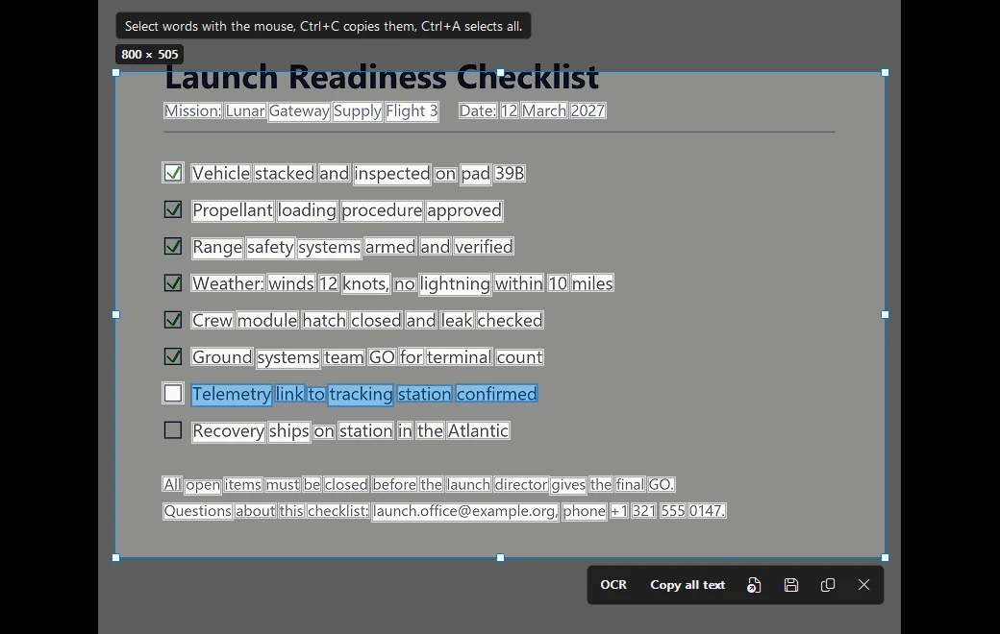

# OCR

OCR (optical character recognition) finds text in an image and lets you copy it. Lucid Viewer uses the text recognition that is built into Windows (`Windows.Media.Ocr`).

## Copy all text from a photo

1. Open the image in Lucid Viewer.
2. Press <kbd>Ctrl</kbd>+<kbd>Shift</kbd>+<kbd>T</kbd>.
3. The text is copied to the clipboard.

## Copy part of the text

Use the screenshot tool to choose the words you need:

1. Press <kbd>PrtScn</kbd> and select the region with the text.
2. Each word is framed when the text is recognized.
3. Select the words with the mouse.
4. Press <kbd>Ctrl</kbd>+<kbd>C</kbd> to copy them.

You can also copy all the text of the region with <kbd>Shift</kbd>+<kbd>PrtScn</kbd>. See [[Screenshot tool|Screenshot-tool]].

## Language

Lucid Viewer chooses the language in this order:

1. The language set in `OcrLanguage`, for example `tr` or `en-US`.
2. If it is empty, the language of a keyboard layout that is not English.
3. If there is no such layout, the Windows display language.

The language must be installed in Windows. To install more OCR languages, use the Windows language settings.

## Settings

| Setting | Default | Meaning |
|---|---|---|
| `OcrLanguage` | empty | Language for text recognition. The language must be installed in Windows. |

See the [[Settings reference|Settings-reference]] for more.
