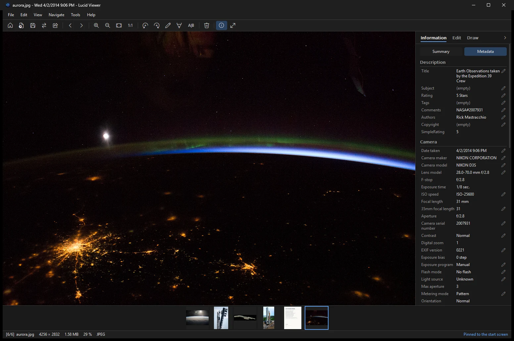

Lucid Viewer helps you sort and clean up photos. You can rate photos with stars, view and edit their metadata, and remove the location before you share them.

## Star ratings

Press <kbd>0</kbd> to <kbd>5</kbd> to give a photo a rating from no stars to five stars.

The rating is written into the file. Explorer and other programs that read the file metadata see it too.

## Filter and sort by rating

Use **Navigation > Star rating** to show only photos with a minimum rating (1 star or more up to only 5 stars), or to sort the folder by rating. This helps you find your best photos in a large folder. The setting `FileDisplayOrder=Rating` keeps the rating order.

## Metadata

Press <kbd>Alt</kbd>+<kbd>Enter</kbd> or choose **File > Metadata** to open the metadata window. You can:

- view the metadata of the photo
- edit the metadata
- remove the GPS location

### Which fields are shown

The Metadata tab shows the common fields (title, tags, camera, exposure, lens, size, location and so on) with names of
Lucid Viewer, translated like the rest of the program. The other fields Windows reads from the file are mostly technical
values (for example `System.Photo.FNumberDenominator` or the maker note), they are hidden and the tab says how many.

**Choose fields...** below the metadata lists all fields of the current photo: check the ones to show, uncheck the ones to
hide. *Show all fields of every file* shows everything, *Only common fields* goes back to the default. The choice is stored
in the setting `MetadataFields` and applies to every photo. **Copy all metadata** always copies all fields.

### Title and Subject

For JPEG files, Windows stores the **Title** and **Subject** in the same field. If you change one, the other one changes too.

## Remove the location

Photos from a phone often store the GPS location of where they were taken. Remove it before you share a photo.

- One click removes the GPS location.
- The location can be removed from JPEG, PNG and WebP files.
- To remove the metadata when you convert a photo, use the `nometa` operation. See [[Converting images|Converting-images]].

## iPhone HDR photos

When Lucid Viewer writes a file that has an iPhone HDR gain map, the gain map is kept.

See the [[Keyboard shortcuts|Keyboard-shortcuts]] page for all keys.
