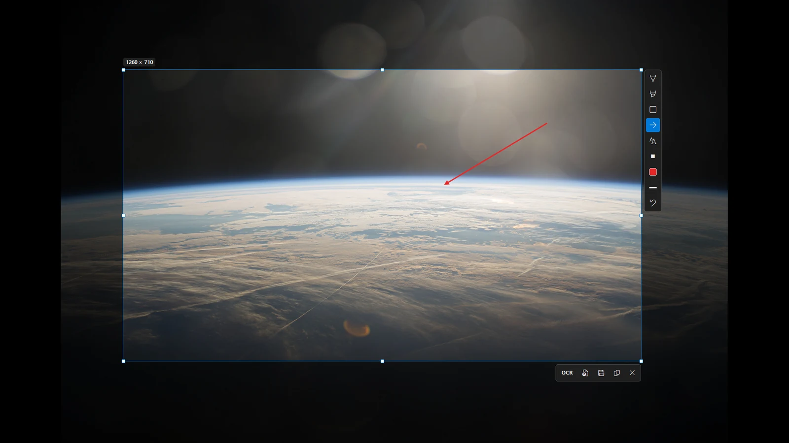

# Screenshot tool

The screenshot tool takes screenshots of your screen. It runs in the notification area, next to the clock. When you press <kbd>PrtScn</kbd>, the screen freezes and you can choose what to keep.



## Take a screenshot

1. Press <kbd>PrtScn</kbd>.
2. Drag a region, or click a window to take that window.
3. Use the tools to draw, pixelate or read the text.
4. Copy the result to the clipboard or save it.

A magnifier shows the pixels under the mouse, with their color. It helps you pick an exact region.

## Copy text from the screen

Press <kbd>Shift</kbd>+<kbd>PrtScn</kbd> and drag a region. The text in that region is copied to the clipboard. This uses the same text recognition as the [[OCR|OCR]] page.

## Start with Windows

The tool runs in the background when you start Lucid Viewer with the `/tray` option:

```
LucidViewer.exe /tray
```

The setup can start the tool with Windows. You can also switch this on or off with **Start with Windows** in the menu of the tool's icon in the notification area.

## Settings

These settings change the screenshot tool. See the [[Settings reference|Settings-reference]] for the full list.

| Setting | Default | Meaning |
|---|---|---|
| `ScreenshotHotkey` | `PrintScreen` | Key for taking a screenshot. Leave it empty to switch this shortcut off. |
| `ScreenshotTextHotkey` | `Shift+PrintScreen` | Key for copying the text of a region. |
| `ScreenshotFolder` | empty | Folder for saved screenshots. Empty uses the Windows Screenshots folder in Pictures. |
| `ScreenshotHistory` | `false` | If `true`, every screenshot is kept in the screenshot folder, also the ones only copied to the clipboard. The start screen then shows them in a row. |

## Windows 11 and Print Screen

Windows 11 gives the <kbd>PrtScn</kbd> key to the Snipping Tool by default. To use Lucid Viewer instead, turn this off in **Settings > Accessibility > Keyboard**. Switch off the option **Use the Print screen key to open screen capture**.

If you do not want the Print Screen key at all, leave `ScreenshotHotkey` empty and use another key, for example `Ctrl+Alt+S`.
